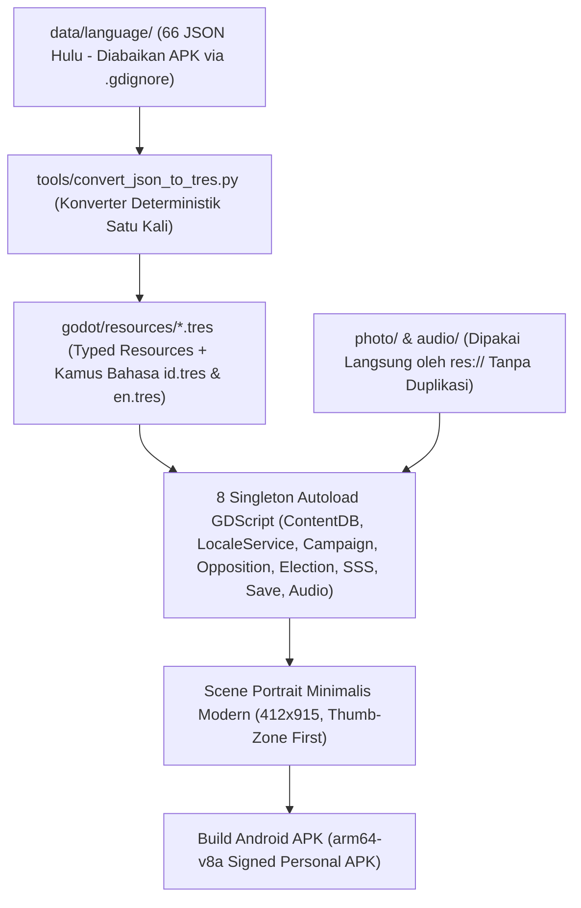

# Dokumen Desain: Porting *Twilight of the Banyan Tree* ke Godot 4 Android

> [!IMPORTANT]
> **Status Dokumen**: Menunggu persetujuan Anda sebelum penulisan rencana implementasi rinci dan pembangunan kode dimulai. Tidak ada berkas di `/home/antigravity/nafta121/Banyan-Tree` yang diubah pada tahap ini.

---

## 1. Tujuan & Visi Produk (*Intent & Why*)

Membangun ulang (*porting*) gim simulasi politik-sejarah ***Twilight of the Banyan Tree*** ke **Godot 4.3+ Android** sebagai **`.apk` koleksi pribadi** yang nyaman dimainkan dengan **satu tangan pada posisi tegak (*portrait*)**, melalui dua transformasi utama:
1. **Konversi Penuh ke Custom `Resource` (`.tres`) Godot**: Mengubah seluruh `66` berkas JSON warisan ([events.json](file:///home/antigravity/nafta121/Banyan-Tree/data/language/english/events.json), [routine.json](file:///home/antigravity/nafta121/Banyan-Tree/data/language/english/actionphase/routine.json), [decrees.json](file:///home/antigravity/nafta121/Banyan-Tree/data/language/english/actionphase/decrees.json), `factions/*.json`, dll.) menjadi `Resource` GDScript bertipe statis yang bersih dari tag HTML warisan saat runtime.
2. **Antarmuka Minimalis Modern (*Clean Editorial Mobile UI*)**: Mengganti tiruan desktop Windows 95/CRT dengan antarmuka kartu modern yang bersih, hemat baterai, dan menempatkan seluruh kontrol interaktif di zona jangkauan ibu jari (*paruh bawah layar*).

---

## 2. Sasaran, Non-Sasaran, & Anti-Sasaran

### 2.1 Sasaran (*Goals*)
1. **100% Paritas Simulasi & Konten Sejarah**:
   - **23 Krisis Historis** (`111` opsi + reaksi 14 media massa), **36 Aksi Rutin**, **35 Dekrit Kepresidenan** (Tiga Pilar Golkar `A-B-G`, *ramping soft-floors*, & 6 dekrit pembubaran/realokasi kursi), serta **10 Fraksi MPR** (`700` kursi, peleburan *Poros Tengah* Giliran 18, *Final Appeal* Giliran 21–22, dan *Horse-Trading Desk* Giliran 22).
   - **AI Oposisi Utuh**: Mesin TNI dua fase (`Patience` $\leftrightarrow$ `Anger`, `militaryShock`, resistensi nasional & *stubbornness*), Mobilisasi Jalanan PDI-P (`0–100%`, 4 tier, lonjakan biaya kuadratik `9x`/`13x`, kunci `0–153`), *Grievance*, penalti main dua kaki PDI-P/Poros Tengah, *walkout* kursi tercemar, serta pembelotan bilik suara rahasia (*secret-ballot defection*).
   - **Sidang Umum MPR 19–20 Oktober 1999**: Perhitungan 7 tahap dengan 5 lapis RNG, syarat menang ganda (`grandTotalFor > grandTotalAgainst` **dan** `grandTotalFor >= 351`), hemisikel vektor 700 kursi interaktif (`1x`, `2x`, `5x`, `10x`, *Lewati*), dokumen TAP MPR No. III/MPR/1999, kartu ekspor PNG *State of the Republic*, dan Epilog.
   - **Mode Pendukung Utuh**: 4 tingkat kesulitan standar + papan 24 kartu *Severe State Situations* (`SSS`), **112 entri Ensiklopedia** (termasuk sakelar esai *Criticism* pada 8 Presiden RI), **59 *Achievements***, pemutar musik **36 lagu asli** + 5 SFX, serta dwibahasa penuh **Bahasa Indonesia & Bahasa Inggris**.
2. **Perbaikan Sekaligus atas 5 Bug Kode Hulu**:
   - Menghidupkan kembali **22 pesan *loading* dwibahasa** dari [loading_messages.json](file:///home/antigravity/nafta121/Banyan-Tree/data/language/english/interface/loading_messages.json) yang sebelumnya mati karena salah jalur `loading.json`.
   - Memperbaiki *GitHub Issue #4* di [sss.js](file:///home/antigravity/nafta121/Banyan-Tree/js/sss.js#L300) agar melepas centang *Hide Forecast* di mode `SSS` benar-benar menampilkan prakiraan efek.
   - Menangani kegagalan muat berkas audio agar pemutar otomatis lanjut ke lagu berikutnya tanpa membeku.
   - Memperbaiki *Weighted Shuffle* dari [music.js](file:///home/antigravity/nafta121/Banyan-Tree/js/music.js#L114-L134) agar menghormati filter genre aktif, menyertakan ke-6 lagu yang belum beratribut `weightedtrack`, dan tersimpan di pengaturan.
   - Memisahkan bus volume `Music` dan `SFX` (agar volume musik `0%` tidak membisukan SFX) serta menyertakan mode `SSS` pada syarat *achievement* ambang statistik (`Med+`).
3. **Fleksibilitas Kabut Informasi & Penyimpanan Koleksi Pribadi** *(Sesuai Keputusan Anda)*:
   - **Sakelar *Tampilkan Angka Eksak (`0–100`)* di Pengaturan**: Bawaannya **nonaktif** (menjaga ketegangan kualitatif asli di mana hanya `PC` dan kursi yang berupa angka), namun kapan saja bisa **diaktifkan** untuk melihat angka `0–100`, bar progres presisi, lantai pengunci dekrit, serta *chip* delta perubahan pasca-pilihan.
   - **Autosave + 5 Slot Simpan/Muat Manual**: Menyediakan *Autosave* otomatis sekaligus **5 slot simpan/muat manual** (plus ekspor/impor berkas cadangan) untuk bereksperimen lintas cabang sejarah **tanpa memblokir ke-59 *achievements***.
4. **Ergonomi Satu Tangan & Efisiensi Baterai**:
   - Resolusi logis `412×915` (`portrait`, `canvas_items`, `expand`), adaptif terhadap *Safe Area* kamera depan & bilah gestur Android, tinggi area ketuk minimum `48dp`, dan `application/run/low_processor_usage_mode = true` agar konsumsi CPU/GPU mendekati `0%` saat layar diam dibaca.
5. **Pengemasan `.apk` Siap Pasang**:
   - Menghasilkan berkas `.apk` Android (`arm64-v8a`) tertanda tangan *keystore* pribadi/debug yang siap dipasang langsung di ponsel Anda.

### 2.2 Non-Sasaran (*Non-Goals*)
- Tidak meniru jendela Windows 95, Windows 98, Mac OS 8, taskbar desktop, 31 skema warna lama, maupun efek shader tabung CRT.
- Tidak memangkas lagu asli untuk aturan publikasi Google Play Store (karena khusus koleksi pribadi).
- Tidak menyertakan draf bahasa Mandarin (`cnsimplified`) yang belum selesai di hulu.

### 2.3 Anti-Sasaran (*Anti-Goals*)
- Meletakkan tab navigasi utama atau tombol pilihan krisis di puncak layar yang sulit dijangkau satu jempol.
- Mengubah rumus matematika politik, ekonomi `PC`, *Stat Gravity*, atau kuorum `351` kursi.
- Menggandakan `300 MB` berkas `audio/` dan `photo/` di dalam repositori.

---

## 3. Pendekatan Arsitektur & Perbandingan Opsi

| Opsi | Ringkasan | Keputusan & Alasan |
|---|---|---|
| **Pendekatan 2 (Dipilih): Konversi Penuh ke `.tres` + UI Minimalis Modern** | Konverter satu kali mengubah seluruh JSON ke `Custom Resource` `.tres` bertipe kuat; UI dibangun ulang sebagai kartu editorial *portrait* bersih. | **Dipilih** — paling bersih secara arsitektur Godot 4, bebas pengurai HTML warisan saat runtime, dan paling nyaman untuk desain satu tangan modern. |
| **Pendekatan 1: JSON Mentah + UI *"Win95 Pocket"*** | Membaca JSON asli saat runtime + konverter HTML ke BBCode dengan bezel Win95 vertikal. | Ditolak — membawa beban markup HTML lama dan membatasi keleluasaan tata letak minimalis modern. |
| **Pendekatan 3: Inti Rust/C# (`GDExtension`) + UI Godot** | Memisahkan mesin matematika ke pustaka native terkompilasi. | Ditolak — memperumit kompilasi silang APK `arm64-v8a` tanpa keuntungan kecepatan berarti untuk gim giliran teks. |

---

## 4. Tata Letak Cabang & Struktur Repositori *(Usulan Arsitek)*

- Seluruh kode Godot dibangun pada cabang Git baru **`godot4-android`** di `/home/antigravity/nafta121/Banyan-Tree` agar cabang `main` tetap bersih sebagai arsip rujukan kode web hulu.
- `project.godot` ditempatkan di **akar repositori** sehingga `res://photo/` dan `res://audio/` langsung terbaca tanpa menyalin ulang berkas media (`0 MB` duplikasi).
- Folder warisan web (`js/`, `css/`, `data/`, `docs/`) dan folder alat konversi (`tools/`) diberi berkas **`.gdignore`** sehingga tidak ikut terbungkus ke dalam berkas `.apk` Android.



---

## 5. Skema Custom `Resource` (`.tres`) & Lokalisasi Dwibahasa

1. **Pemisahan Mekanika & Bahasa (`LocalePackData`)**:
   - `godot/resources/locales/id.tres` (**bahasa bawaan awal**) dan `en.tres` menyimpan kamus terindeks `Dictionary[String, String]` hasil penggabungan seluruh teks antarmuka, krisis, aksi, dekrit, fraksi, pustaka, dan pencapaian.
   - Teks tutorial pada `id.tres` & `en.tres` disesuaikan ringan agar merujuk ke antarmuka *portrait* baru dan menjelaskan sakelar *Tampilkan Angka Eksak*.
   - Kode warna warisan (`§R...§!`, `<font color>`) diubah saat konversi menjadi BBCode bertema (`[b]`, `\n`, token warna semantik yang otomatis beradaptasi antara tema gelap & terang).
   - Seluruh `111` reaksi pers pada krisis dipecah rapi saat konversi menjadi kolom terstruktur (`press_outlet`, `press_category`, `press_headline_key`, `press_body_key`).
2. **Kelas `Resource` Bertipe Statis (`godot/scripts/resources/`)**:
   - `GameCatalogData` (indeks utama seluruh koleksi resource).
   - `CrisisEventData` & `EventOptionData` (`23` krisis, `111` opsi).
   - `RoutineActionData` (`36` aksi rutin beserta cabang syarat lulus/gagal & penanda interaksi militer).
   - `DecreeData` (`35` dekrit beserta syarat, mutex, pemutus Pilar Golkar `A/B/G`, *ramping locks*, dan aturan realokasi kursi).
   - `FactionData`, `FactionDealData`, & `FactionMergedData` (`10` fraksi + status gabungan *Poros Tengah*).
   - `DifficultyData` & `SSSCardData` (`4` kesulitan standar + `24` kartu DAG *Severe State Situations*).
   - `LibraryEntryData` (`112` entri + esai `alt` *Criticism* untuk 8 Presiden), `AchievementData` (`59` pencapaian), dan `MusicTrackData` (`36` lagu + tag kuadran *Weighted Shuffle*).

---

## 6. Desain Antarmuka Minimalis Modern Satu Tangan

### 6.1 Tema & Tipografi
- **Tema Bawaan — *Midnight Slate* (Gelap OLED)**: Latar `#0F1419`, kartu `#182028` bersudut membulat `14dp`, garis tepi `#26323F`, teks `#ECF2F8`, aksen emas `#E5A93C`.
- **Tema Alternatif — *Editorial Paper* (Terang)**: Latar kertas hangat `#F6F4EF`, kartu `#FFFFFF`, teks tinta `#1A1D21`, aksen merah marun `#9E2A2B`.
- Pengaturan skala ukuran huruf dinamis (`85%` – `140%`) untuk kenyamanan membaca artikel panjang.

### 6.2 Tata Letak Tiga Zona & Mode Tampilan Angka (`show_exact_numbers`)

```text
┌────────────────────────────────────────┐
│ [Safe Area Kamera]                     │
│ 14 Jun 1999 • Giliran 1/23      PC: 50 │ <- Header Ringkas (hanya informasi;
│ Stabilitas: Rawan  [atau 41 • Rawan*]  │    tidak perlu dijangkau jempol!)
│ TNI: Waspada       PDI-P: Siaga        │    (*angka tampil jika sakelar ON)
├────────────────────────────────────────┤
│ ┌────────────────────────────────────┐ │
│ │     [ Foto Krisis Rasio 16:9 ]     │ │ <- Zona Baca Tengah (ScrollContainer
│ └────────────────────────────────────┘ │    nyaman digulir dari tengah-bawah)
│ REALITAS PASCA-PEMILU                  │
│ PDI Perjuangan unggul 33,7% suara...   │
├════════════════════════════════════════┤ <- ZONA JANGKAUAN JEMPOL (45% Bawah)
│ ┌────────────────────────────────────┐ │
│ │ Tunda pengesahan hasil KPU         │ │ <- Kartu Pilihan / Aksi (tinggi >=52dp)
│ │ [Prakiraan efek jika diaktifkan]   │ │
│ ├────────────────────────────────────┤ │
│ │ Ucapkan selamat kepada Megawati    │ │
│ └────────────────────────────────────┘ │
├────────────────────────────────────────┤
│ [Agenda]  [Stat]  [MPR]  [Buku]  [≡]   │ <- Navigasi Bawah 5 Tab + Safe Area
└────────────────────────────────────────┘
```

- **Perilaku Sakelar *Tampilkan Angka Eksak (`0–100`)* (`show_exact_numbers`)**:
  - **Saat MATI (*Default*)**: Setia pada kabut informasi asli—hanya `PC` dan jumlah kursi MPR yang berupa angka; ketujuh statistik nasional, stabilitas, dan loyalitas fraksi ditampilkan sebagai **label kualitatif + indikator segmen kasar + panah tren terakhir (`↑`/`↓`)**, dan lembar reaksi pers tidak membocorkan angka delta.
  - **Saat MENYALA**: Menampilkan angka presisi `0–100`, bar progres kontinu, angka lantai/plafon dekrit (`minStats` / `maxCendana`), persentase meter `TNI` & `PDI-P`, serta **chip delta numerik pasca-pilihan** pada lembar reaksi pers dan *telex* hasil aksi.
- **Semua Dialog Berbentuk *Bottom Sheet***: Lembar Reaksi Pers (14 masthead editorial modern), detail fraksi, *Horse-Trading Desk* (Giliran 22), serta konfirmasi dekrit muncul dari bawah layar sehingga tombol **`Lanjutkan` / `Tutup`** selalu berada tepat di bawah ibu jari.
- **Papan 24 Kartu `SSS` Ramah *Portrait***: Menyediakan **Mode Daftar 4 Jalur** (paling cepat diatur satu tangan) sekaligus **Mode Peta Node 2D** (geser-cubit kanvas dengan garis prasyarat).

---

## 7. Arsitektur Mesin GDScript & Penyimpanan *Multi-Slot*

### 7.1 Delapan Singleton *Autoload* (`godot/scripts/autoload/`)
1. `ContentDB`: Memuat `GameCatalogData.tres` saat layar muat pembuka (sambil menampilkan 22 pesan *loading* acak yang telah dipulihkan).
2. `LocaleService`: Mengelola kamus `id.tres` / `en.tres` dan interpolasi rekursif `$VAR$`.
3. `CampaignManager`: Menjalankan siklus 23 giliran, rumus 7 statistik, `stoch_round()`, *Stat Gravity* (`>78 -> -2`), `globalMalus`, `pcGainFactor`, Tiga Pilar Golkar (`A-B-G`), *ramping floors*, peleburan *Poros Tengah* T18, *Final Appeal*, dan *Horse-Trading*.
4. `OppositionManager`: Menjalankan mesin TNI, PDI-P, *Grievance*, penalti koalisi ganda, *tainted seats*, dan *secret-ballot defection*.
5. `ElectionManager`: Menjalankan 7 tahap penghitungan suara Sidang Umum MPR, kuorum tetap `351` dari `700` kursi awal, serta pembuatan kartu hasil PNG beresolusi tinggi (`SubViewport` $\rightarrow$ PNG).
6. `SSSController`: Mengelola prasyarat DAG 24 kartu dan interpolasi `lerp(level, n, h, m)`.
7. `AchievementService`: Memeriksa ke-59 syarat *achievement* (termasuk perbaikan dukungan mode `SSS`) dan menampilkan *toast* pencapaian.
8. `SaveAndSettingsService` & `AudioController`: Mengelola bus audio terpisah (`Music` & `SFX`), pemutar 36 lagu + *Weighted Shuffle*, serta penyimpanan berkas.

### 7.2 Skema *Autosave* + 5 Slot Manual (`user://saves/`)
- **`autosave.tres`**: Diperbarui otomatis pada setiap keputusan krisis, aksi eksekutif, lobi fraksi, dan *horse-trading* (termasuk tepat sebelum memasuki `ElectionManager` sehingga malam pemungutan suara pun tetap tercatat aman sebelum dimulai).
- **`slot_1.tres` s/d `slot_5.tres`**: Dapat disimpan, diberi catatan singkat, dimuat ulang kapan saja di tengah permainan (melakukan *clean state restore* atas seluruh singleton tanpa kebocoran UI), maupun diekspor/diimpor sebagai berkas cadangan—**tanpa membatalkan kelayakan ke-59 *achievements***.

---

## 8. Rencana Verifikasi & Pembungkusan `.apk`

1. **Suite Pengujian Otomatis Headless (`godot --headless -s godot/tests/run_tests.gd`)**:
   - Memastikan keutuhan konversi `100%` data `.tres` dan `0` kunci terjemahan hilang pada `id.tres` & `en.tres`.
   - Menguji determinisme rumus inti (*Stat Gravity*, Tiga Pilar Golkar, peleburan 163 kursi *Poros Tengah*, resistensi TNI/PDI-P, simpan/muat multi-slot, dan kuorum `351` pada simulasi Sidang Umum MPR).
   - Menguji instansiasi seluruh *scene* `.tscn` tanpa galat.
2. **Kompilasi `.apk` Android**:
   - Mengekspor berkas **`TwilightOfTheBanyanTree-Portrait-arm64.apk`** tertanda tangan *keystore* pribadi secara lokal dan menyertakan workflow opsional `.github/workflows/build-android-apk.yml` di cabang `godot4-android`.

---

## 9. Hal yang Diserahkan kepada Pelaksana (*Left to the Builder*)
- Detail warna aksen mikro per fraksi agar tetap kontras pada tema gelap maupun terang.
- Pemecahan sub-komponen kartu UI internal dan durasi animasi transisi halus (`120–180 ms`, patuh pada opsi *Kurangi Animasi*).
- Mekanisme penyimpanan berkas gambar PNG *State of the Republic* pada Android modern (ke folder dokumen aplikasi / dialog simpan standar tanpa izin penyimpanan usang).
